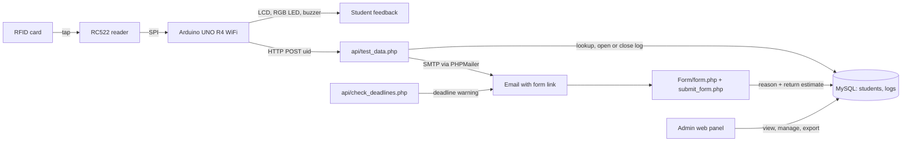

# Architecture

GitHub renders the diagram in the repository README; this page shows the source.

## Components

- **Arduino firmware** (`Arduino Code/Pravesh.ino`): connects to Wi-Fi, reads the card UID through the RC522, shows status on the LCD, LED and buzzer, and sends `uid=<hex>` by HTTP POST to `/rfidattendance/test_data.php`.
- **Scan endpoint** (`api/test_data.php`): stores the raw scan, looks the UID up in `students`, then either updates `return_time` on the open log or inserts a new log with a 22:00 default deadline and emails the form link.
- **Form** (`Form/form.php`, `Form/submit_form.php`): the student states the reason and an estimated return time, which are written back to the log.
- **Deadline check** (`api/check_deadlines.php`): finds logs nearing their deadline and sends a warning email.
- **Admin panel** (`api/`): login, Users, Manage Users, Users Log and Excel export.
